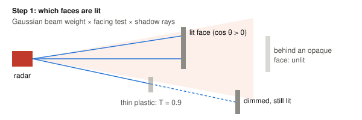
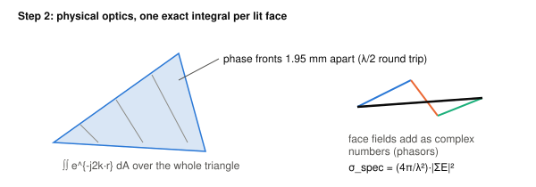
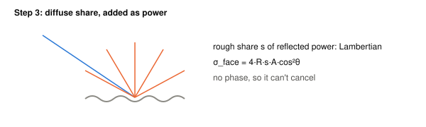
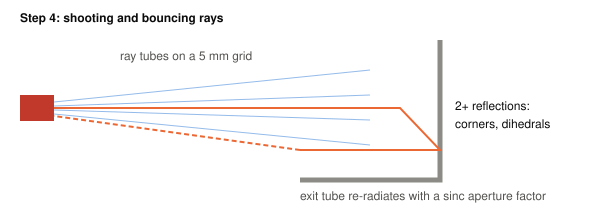
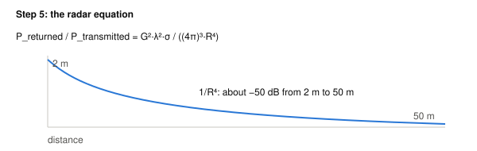

# How the solver finds the cross section

The solver in [radar_detector/rcs.py](../radar_detector/rcs.py) works on one triangle mesh for the whole scene. Every face carries a material with a reflectance R, an absorptance A and a roughness s. Whatever isn't reflected or absorbed passes through, so the transmittance is T = 1 − R − A. The scene is merged into that mesh by `build_target` in [radar_detector/geometry.py](../radar_detector/geometry.py).

At 77GHz the wavelength is 3.89mm. Most faces on a bike are many wavelengths across, so they can't be treated as point scatterers. That one fact drives most of the choices below.

The solve runs in two stages. The first, `illuminate`, does everything that doesn't depend on frequency: the geometry, the beam, the shadow rays and every multi-bounce ray path. The second, `sum_fields`, turns that into an RCS at one frequency, which is only NumPy sums. I split it this way so that averaging over the radar's band (see [What the numbers mean](numbers.md)) reuses one set of ray casts for every frequency. Steps 1 and the ray tracing in step 4 belong to the first stage; the rest belongs to the second.

## Step 1: which faces are lit

Each face gets its own direction and range from the radar, rather than one plane wave for the whole scene. Three things decide how much power reaches it:

1. **The beam.** The radar's beam is a Gaussian with the chosen −3dB cone (20° by default), so a face 10° off boresight gets half the power of one on it.
2. **The facing test.** A face whose normal is perpendicular to the ray gets nothing. Surfaces are treated as two-sided, so a face lit from behind still counts.
3. **Shadowing.** A ray is cast from the radar to every candidate face's centroid. Every surface it crosses first multiplies the power by its transmittance. A metal tube (T = 0) shadows the face completely, while a thin ABS shell (T = 0.92) only dims it.

Of note, the shadow test used to cast up to 32 hits per ray for every face. It now casts one first-hit ray, and only follows up with the full multi-hit cast when the first thing in the way is see-through. An opaque first blocker settles the face as unlit no matter what lies behind it. The result is the same, and on the baseline biker the shadow test dropped from 0.17s to 0.09s.

## Step 2: physical optics

Each lit face contributes the exact closed-form integral of the round-trip phase across its triangle, e^(−j2k·r). It's weighted by its reflection amplitude √(R(1−s)), the cosine of the incidence angle, the beam strength at the face and its shadow transmission. The integral is in `triangle_phase_integral`, which uses a divided-difference form so it stays stable when two corners of a triangle have the same phase.

These face fields are added as complex numbers, so faces can reinforce or cancel each other:

σ_spec = (4π/λ²)·|Σ fields|²

This is why a flat plate gives a huge return when it faces the radar and almost nothing when it's tilted a few degrees. The phase across it stops lining up.

## Step 3: diffuse reflection

The rough share s of each face's reflected power scatters like a Lambertian surface instead of a mirror. Its monostatic RCS is σ = 4·ρ·A·cos²θ, with ρ = R·s and A the face area. These terms add as power, not phase, so they can't cancel. Clothing (s = 0.5) and tyres (s = 0.3) get most of their return this way.

Diffuse power doesn't depend on frequency, so band averaging leaves it unchanged.

## Step 3b: retroreflective faces

Faces with a retroreflective material (see [Materials](materials.md)) send a share q of their reflected power straight back toward the radar. I added this to model tags like the metalens reflector in Ghasemi et al. (2026), which are built to return radar from a wide range of angles. Nothing in steps 2 to 4 can produce that. A flat face reflects like a mirror, so it only returns when it faces the radar, and a corner reflector's lobe is fixed by its geometry.

A real tag does this with internal structure: lenses, antenna pixels or paired antennas. I don't model any of that. I model what it does, which is phase conjugation. The tag re-radiates the incoming wave back along its own path, so every point on it returns to the radar with the same total phase. That gives three rules:

1. **Each connected patch of retro faces is one aperture.** Faces that share a vertex belong to the same patch. Every lit face in a patch uses the same phase reference: the patch's amplitude-weighted mean range. That's what keeps a tilted tag coherent. A metal plate tilted 30° loses its return because its faces sit at different ranges and their phases spread out; a retro tag doesn't.
2. **The field scales with projected area.** Each face contributes √(R·q)·A·cosθ, times its beam weight and shadow transmission, so a patch returns σ = (4π/λ²)·|Σ √(R·q)·A·cosθ·g|². At normal incidence that's exactly a metal plate of the same size, scaled by R·q. Off-axis it falls only as cos²θ.
3. **Coverage is limited and one-sided.** The return holds up to the material's coverage half-angle from the face normal (g = 1), then rolls off to zero over the next 10° with a raised cosine. It only works from the side the face normal points to.

The retro field is added coherently with the physical optics and multi-bounce fields, and it shows up in its own line of the breakdown. Separate patches, such as two tags on either side of the bike, are separate apertures with their own phase.

Of note, retro behaviour only applies to faces the radar lights directly. A multi-bounce ray that lands on a retro face reflects off its specular share like any other face.

## Step 4: shooting and bouncing rays

Physical optics only sees one bounce. A corner reflector returns almost all of its power after two or three bounces, so single-bounce PO misses it entirely. Shooting and bouncing rays (SBR) is the part of the solver that catches it:

1. A grid of ray tubes is fired from the radar across the target, 5mm apart by default. The grid is clipped to the beam, and coarsened if it would exceed 400,000 rays.
2. Each tube starts with the beam's weight at its angle. At every hit, it either reflects (mirrored about the face normal, times √(R(1−s))) or, if the face has T ≥ 0.5, carries on straight through, times √T.
3. Tubes are traced through up to 3 reflections by default.
4. After its second reflection and every one after, a tube checks whether its way back to the radar is clear. If so, it re-radiates toward the radar.
5. That re-radiated field uses a ray-tube aperture factor: a sinc in each transverse direction, from the tube's width and the angle between where it's heading and where the radar is. A tube heading straight back gives a full return. One heading a few degrees off gives much less.
6. These fields are added coherently with the physical optics field from step 2.

To keep the band average exact, the tracing stores each exit's amplitude, direction, tube width and path length, not the aperture factor itself. The aperture factor depends on frequency, so `sum_fields` recomputes it for every frequency.

The trihedral test in [Validation](validation.md) checks this step against the closed-form RCS of a 10cm corner reflector.

## Step 5: the radar equation

The RCS is turned into returned power with the monostatic radar equation, with an ideal Gaussian-beam antenna gain of G = 16·ln2/θ² for a cone of θ radians (about 19.6dBi at 20°):

P_returned / P_transmitted = G²·λ²·σ / ((4π)³·R⁴)

That 1/R⁴ term is why returned power drops by roughly 50dB between 2m and 50m even when σ barely changes. It's also why the Results tab leads with the change vs. the biker alone instead.

## Per-object values

Each object's RCS is its own physical optics field and its multi-bounce field (each bounce path credited to the face it last left from), added coherently, plus its diffuse power. For a scene with one object, that equals the total exactly.

Of note, up to commit 69677f2 the multi-bounce part was added as power, ray by ray. That undercounted corner reflectors badly: a 10cm corner behind the saddle showed up as 11% of the return when it was really 97% of it. That's fixed now, and there's a test for it.

## Speed

On my Mac (M-series, 10 cores) the baseline biker at 10m solves in about 0.15s, band-averaged over 9 frequencies. That's with Embree, the ray-casting library trimesh uses when it's installed. Without it, trimesh silently falls back to a pure-Python intersector and a single solve takes 20s or more. The app shows a banner when that happens, and `python run.py --check` prints which engine is active.

The aspect sweep (72 bearings) and the comparison charts (200 solves) spread across processes. They take about 1.4s and 5s respectively, down from about 25s and 70s.
